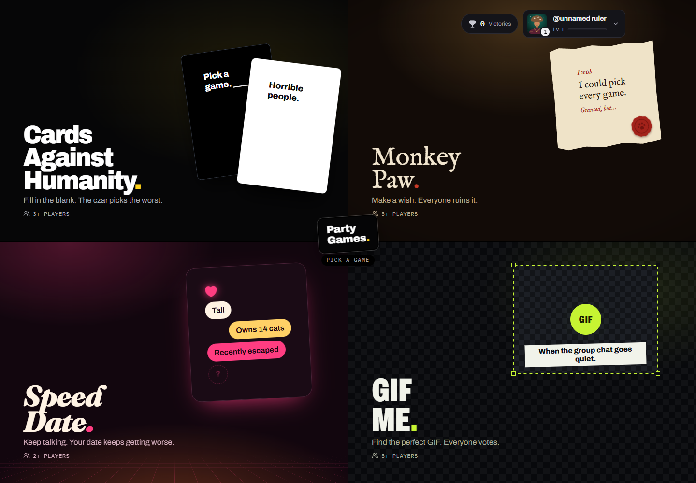
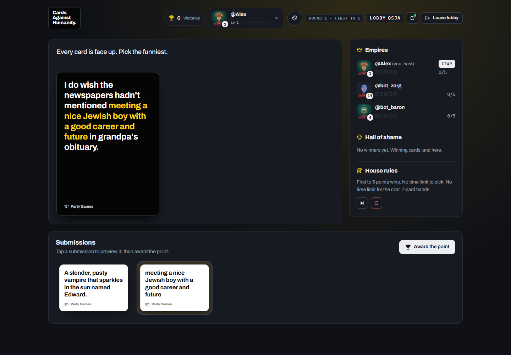
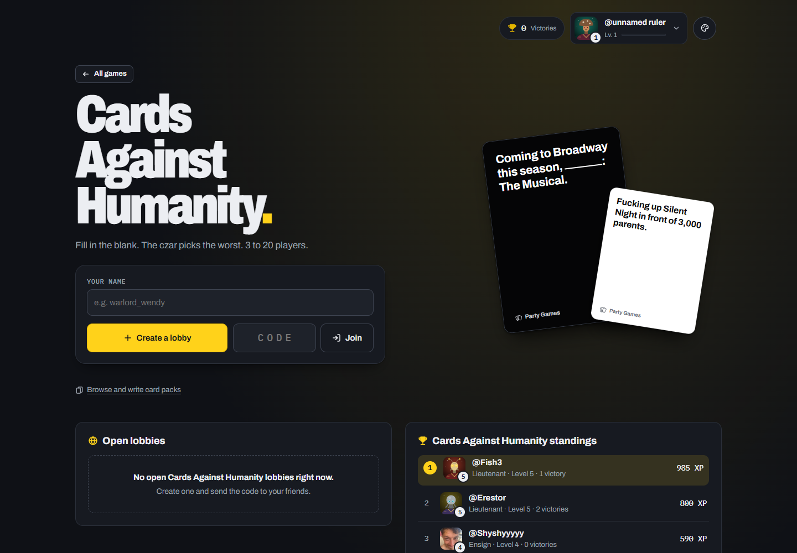
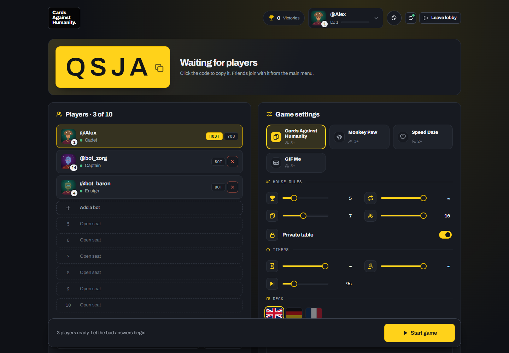

# Party Games

Four browser party games, one room code. Pick a game, invite a few friends, and switch games from the lobby without everyone having to rejoin.

**[Play in your browser](https://ze-chr0me.github.io/party-games/)**



## What's on the table

| Game | Players | How it works |
| --- | --- | --- |
| **Cards Against Humanity** | 3+ | Fill in the blank with cards from your hand. The rotating czar picks the best bad answer. Includes bundled packs and a custom pack editor. |
| **Monkey Paw** | 3+ | Make a wish. Everyone else writes a "Granted, but..." twist, and the wisher picks a winner. |
| **Speed Date** | 2+ | Pitch a date while new traits keep appearing. The others write secret traits and rate your performance. |
| **GIF Me** | 3+ | Choose a situation or upload a photo. Everyone else finds a reaction GIF, then the table votes. |

The host sets the language, timers, player limit and points to win. Cards and prompts are available in English, French and German. Profiles have custom portraits, XP, victories and per-game standings; a personal account code or QR code lets you use the same profile on another device.

## Play with friends

1. Open the site, pick a game and enter your name.
2. Create a lobby and share its four-letter code, or enter a friend's code to join. Public tables also appear under **Open lobbies**.
3. The host chooses the rules and starts once enough players have joined. Use **Private table** to keep the room out of the public list.

Keep personal account codes private: anyone with your code can use your profile. They are separate from lobby codes.

## A look inside

Judging a round of Cards Against Humanity:



<details>
<summary>Home screen and lobby</summary>





</details>

Screenshots taken locally with the built-in test bots.

## Run locally

There is no build step or package install. Serve the repository root with any static HTTP server. For example, with Python installed:

```sh
python -m http.server 8765 --bind 127.0.0.1
```

Open [localhost:8765](http://localhost:8765). Use HTTP rather than opening `index.html` directly.

Local serving still connects to the Firebase project configured in `shared/core.js`; multiplayer, profiles and GIF search need an internet connection. To use your own backend, follow the deployment steps below.

On `localhost`, `127.0.0.1` or `::1`, the host gets an **Add a bot** seat in the lobby. Bots make random choices in all four games and are removed when the host leaves. This is useful for trying a round on your own.

## Deploy your own copy

The app is plain HTML, CSS and JavaScript. GitHub Pages can serve the repository root directly.

1. Create a Firebase project with **Anonymous Authentication**, **Firestore** and **Realtime Database** enabled. Add your site's hostname to the authorized authentication domains.
2. Set the public Firebase web configuration in [`shared/core.js`](shared/core.js), including `databaseURL`. When updating the existing deployment, keep its current Firebase project.
3. Publish [`firestore.rules`](firestore.rules) and [`database.rules.json`](database.rules.json) in the corresponding Firebase Console Rules tabs. Publish the rules before using personal account codes.
4. For GIF Me, set `KLIPY_KEY` in [`gif-me/gm.js`](gif-me/gm.js) to your public client key from the Klipy Partner Panel. See the [GIF provider notes](docs/GAMES.md#gif-me-gm-min-3) for content filtering and API details.
5. Publish the files to your static host. For GitHub Pages, select the repository root as the publishing directory.

The checked-in `firebase.json` also supports deploying Firestore rules through the CLI. For the existing project:

```sh
npx firebase-tools login
npx firebase-tools deploy --only firestore:rules --project cardsagainsthumanity-9090e
```

Realtime Database rules are published separately through the console.

## Working on the code

| Path | Contents |
| --- | --- |
| `index.html` | Page shell and script loading order |
| `shared/` | Styles, Firebase connection, profiles, lobby, presence and game dispatch |
| `cah/` | Cards Against Humanity logic and bundled card packs |
| `monkey-paw/`, `speed-date/`, `gif-me/` | Each game's logic and prompts |
| `i18n/` | Card translations and translation review notes |
| `dev/bots.js` | Local test players |
| `tests/` | Game logic, synchronization and Firebase rules tests |

Scripts share globals and load in order; there is no bundler. The [game registry contract](docs/GAMES.md) explains how games plug into the shared lobby and how player actions are synchronized.

See [tests/README.md](tests/README.md) for the account-code and GIF Me rules tests, including dependencies and Firestore emulator commands. These use a local demo project rather than production data.

## Credits and licence

Card text comes from [JSON Against Humanity](https://github.com/crhallberg/json-against-humanity) by Chris Hallberg. Cards Against Humanity LLC releases its cards under [CC BY-NC-SA](https://creativecommons.org/licenses/by-nc-sa/4.0/). The German and French translations use the same licence; see [translation coverage](i18n/UNTRANSLATED.md).

This is a non-commercial project shared under the same terms. It is not affiliated with or endorsed by Cards Against Humanity LLC.
